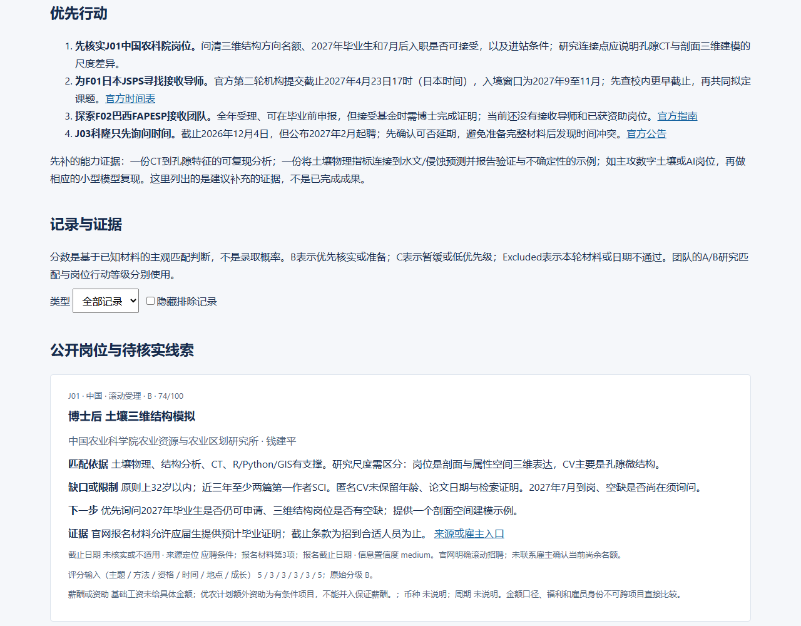

# Global Postdoc Finder｜全球博士后搜索助手

## English overview

A reusable Codex workflow that helps researchers discover postdoctoral opportunities, verify source evidence, check eligibility, and prioritize next actions using their research profile and location preferences.

- **Workflow:** profile → search → source verification → eligibility checks → weighted match score → action priority and tracker. Vacancies, fellowships, and potential hosts remain separate.
- **Four tasks:** first-pass search, verification of a recruitment link/screenshot against official sources, saved-list refresh, and application evidence preparation. Each live run reports its coverage and unresolved checks.
- **Implementation:** Codex and its tools perform CV interpretation, web search, and evidence judgments. Standard-library Python helpers calculate scores, apply decision gates and compare saved snapshots; they do not implement a standalone crawler or agent platform.
- **Real example:** a 2026-11-18 global trial used 35 queries and produced 18 records: 11 vacancy notices/leads, 4 fellowships, and 3 hosts. Zero vacancies had all candidate eligibility and start-date conditions confirmed. [Read the case](examples/anonymous-trial-2026-11-18/case-study.md) or [inspect the structured results](examples/anonymous-trial-2026-11-18/original-results.json).
- **Validation:** unit tests cover decision rules, saved-case replay and list comparison. [GitHub Actions](https://github.com/TylerZhang130666/global-postdoc-finder/actions) runs checks on Linux/Python 3.11 and Windows/Python 3.13. Search accuracy, time savings, and comparative improvements have not been measured.

### Actual report preview



Screenshot of the original HTML report, showing follow-up actions and a record with evidence gaps. This is the **2026-11-18 historical snapshot**, not a claim that the vacancy is currently open. [Download the report](examples/anonymous-trial-2026-11-18/Global_Postdoc_Trial_Report.html) and open it in a browser to use its filters.

## 中文介绍

一个可复用的 Codex Skill，用于根据使用者自己的研究背景、方法、成果、地区偏好和入职时间，搜索、核实、比较并排序全球博士后及相邻研究岗位。

它不会默认欧洲、美国或名校优先。使用者指定哪个国家、地区、城市或机构优先，它就先搜索哪里；只有明确说“全球都可以”时，才进行全球分区搜索。

项目定位是**由 Codex 执行的 AI 搜索与决策工作流**。CV理解、联网检索、来源解释和匹配判断由模型及可用工具完成；Python辅助脚本负责已整理记录的计算与分级，以及常见隐私模式扫描。目前没有独立实现完整的CV解析、招聘抓取或Agent运行平台。

## 它能做什么

- 从CV或个人填写的资料中提取研究方向、方法和成果证据。
- 根据使用者指定的国家和地区优先级搜索。
- 查询各国官方招聘网站、研究机构、大学、基金项目和实验室页面。
- 区分公开招聘岗位、需要申请的博士后基金、潜在导师或团队。
- 核实截止日期、招聘状态、国际申请资格、签证信息和薪酬原文。
- 按研究匹配度、方法匹配度、申请资格、时间和地点等因素评分。
- 生成A/B/C优先级、差距分析和下一步申请行动。
- 提供岗位追踪CSV模板和发布前隐私扫描工具。
- 将资格证据缺失标为待核实，区分确认不符合与尚无证明。
- 记录机构、日期、研究任务冲突，区分第一阶段与受邀阶段。
- 分开输出数值匹配分档与行动等级，并解释降级原因。

## 适合谁

- 正在寻找博士后、Research Fellow、Research Associate或Research Scientist岗位的博士生和博士毕业生。
- 希望比较不同国家或地区研究机会的人。
- 不知道如何把自己的博士研究方向转化为招聘关键词的人。
- 需要建立长期岗位追踪和导师联系系统的人。

本Skill适用于不同学科，不限于某个研究领域。

## 安装

下载或克隆本仓库，将包含 `SKILL.md` 的整个目录放入你的 Codex skills 目录，并命名为 `global-postdoc-finder`。保留 `agents`、`assets`、`references` 和 `scripts`；`examples`、`tests`用于查看案例与执行规则测试。

也可以直接让Codex从本仓库安装该Skill。

## 快速使用

安装后，可以直接使用这四种入口：

```text
使用 $global-postdoc-finder，根据我的背景，帮我做一次首轮搜索。
使用 $global-postdoc-finder，核实这条小红书招聘信息/截图/链接，找到官方来源。
使用 $global-postdoc-finder，更新我上次的岗位清单，告诉我哪些发生了变化。
使用 $global-postdoc-finder，针对这个岗位，整理申请条件和我需要准备的材料。
```

**首轮不必先填一长份英文资料。** 给出研究方向与方法、毕业及入职时间、优先地区、目标机会、必要条件这五项即可；已有CV可直接提取。复制[中文简版模板](assets/candidate-quickstart-zh.md)，未知事项先留待核实，只有具体招聘涉及某项资格时再补问。

单条核验只需提供可读取的帖子文字、截图或链接；没有个人背景时先查招聘真实性与状态，不计算个人匹配分。截图场景已有工作流说明，本轮实际演示验证的是官方链接，尚未做截图识别实测。

想一次说明搜索优先级时，可以这样写：

```text
使用 $global-postdoc-finder，根据我的CV寻找博士后。

第一优先：德国、荷兰
第二优先：加拿大、新加坡
排除：美国
预计入职时间：明年7月以后
要求：只保留对国际申请人开放的机会。

请分别列出公开招聘岗位、博士后基金和潜在导师，并提供官方链接、截止日期、匹配度、信息可信度和下一步行动。
```

只想搜索指定国家时，可以这样写：

```text
使用 $global-postdoc-finder，只搜索日本和新加坡的博士后机会，不要扩展到其他国家。根据我的研究方向生成当地常用的岗位关键词，并优先查询官方招聘网站。
```

如果确实没有地区偏好：

```text
使用 $global-postdoc-finder 做全球博士后搜索。我没有地区偏好，但要求岗位对国际申请人开放，合同至少两年。请按地区分组，再按研究匹配度排序。
```

## 使用前建议准备

- CV或简化后的研究经历
- 研究方向和主要方法
- 代表性论文、项目、软件、数据或其他成果
- 第一优先国家、地区或机构
- 可以接受的第二优先地区
- 明确排除的地点
- 预计毕业和可入职时间
- 是否需要签证支持
- 对合同期限、薪酬或工作形式的要求

上面是可按需补充的详细资料，并非开始搜索的必填表。首轮用[五项中文简版](assets/candidate-quickstart-zh.md)即可；需要完整梳理时，再用[详细画像模板](assets/candidate-profile-template.md)。只有某条真实招聘要求涉及国籍、居留、年龄或申请阶段时，才私下补充最少必要的资格回答；不需要为公开案例提供证件、完整生日或住址。未披露的信息保持未知，不根据语言、姓名或学历背景推断。

## 这次使用会得到什么

先回答三件事：**哪些机会值得看、哪些条件需要核实、下一步做什么**，再提供证据和结构化记录。

| 场景 | 主要输出 | 示例或模板 |
|---|---|---|
| 首轮搜索 | 分开的岗位、基金与团队，待核实条件、行动和覆盖缺口 | [真实匿名试跑](examples/anonymous-trial-2026-11-18/case-study.md) |
| 核验一条信息 | 原帖说法与官方证据对照、状态、截止及申请入口 | [科隆岗位本次重新核验](examples/single-lead-verification-2026-11-18.md)、[核验模板](assets/lead-verification-template.md) |
| 更新旧清单 | 新增、重复、条件变化、关闭、未重新确认，保留前后判断 | [合成的差异演示](examples/list-refresh-demo/README.md)；不代表真实岗位变化 |
| 申请准备 | 招聘要求—我的证据—待补材料；有依据的咨询或申请草稿 | [操作与对照表](references/task-workflows.md#application-preparation) |

### 来源覆盖：没找到、没搜索、打不开分别记录

[结构化来源目录](references/source-catalog.md)按地区、学科、机会类型、搜索方式、登录要求和最近检查情况选入口；机器可读数据在[JSON目录](references/source-catalog.json)。包含MSCA/Hosting、香港RGC与高校招聘、澳洲雇主入口，以及CORDIS、GEPRIS、NIH RePORTER、UKRI等不同用途来源。项目数据库用于发现团队，Hosting表示接收意向，都不等于现成岗位。

每次联网报告单独记录实际查过什么：`未搜索`、`已查但无保留结果`、`已查并保留结果`、`部分可读`、`无法访问`。渠道首页能打开不等于站内查询成功；目录更新时间也不是每个岗位的核查时间。见[覆盖规则](references/task-workflows.md#search-coverage)、[空模板](assets/search-coverage-template.json)和[本次单条核验日志](examples/single-lead-coverage-2026-11-18.json)。

更新旧清单时，搜索中不再出现某条记录只意味着需要重新确认；不能直接判为关闭。离线对比脚本保存新旧证据，只对输入做比较，本身不会重新访问网页。

## 结果如何分类

- **岗位与招聘线索**：明确区分已核实在招、滚动招聘、已过期和状态未确认；线索不能直接当作可申请岗位。
- **博士后基金**：需要候选人和导师共同申请的资助，不等于已经获得岗位。
- **潜在导师或团队**：研究方向匹配，但尚未确认存在空缺，适合联系或长期关注。

搜索结果先按照使用者指定的国家和地区优先级排列，再在同一优先级内部按照匹配度排序。学校名气不作为独立评分项目。

数值匹配分档：A为75分及以上，B为55分至不足75分，C为不足55分。**行动等级另行判断**：

| 行动等级 | 含义 |
|---|---|
| A | 分数至少75，来源与当前入口已核实，必需资格与时间条件均有支持。 |
| B | 值得优先核实或准备；也包括高分但关键资格未知、或尚未开放的后续轮次。 |
| C | 低匹配、来源冲突/未核实、入口关闭或邀请未确认，暂缓申请。 |
| Excluded | 确认不符合必需条件，或岗位已过期；先排除再评分。 |
| Host only | 只表示潜在团队；研究匹配不等于有空缺或经费。 |

例如，“CV没有写荷兰语”属于证据未知；“确认不能满足公告必需语言”才是失败。分数、来源可信度、资格状态、申请阶段和下一步分别保留。规则、JSON输入结构与脚本用法见 [`screening-and-scoring.md`](references/screening-and-scoring.md)。

## 全球网站参考

各国官方入口、常用岗位名称和本地语言关键词见：

- [`references/global-postdoc-resources.md`](references/global-postdoc-resources.md)
- [`references/中文使用指南.md`](references/中文使用指南.md)

参考范围包括欧洲、美国、加拿大、日本、新加坡、韩国、中国大陆、中国香港、中国台湾、印度、澳大利亚、新西兰、中东、非洲、拉丁美洲以及国际组织。

## 匿名案例与真实运行结果

### 2026年11月18日全球首轮试跑

输入为一位研究农业土壤物理、结构变化、冻融、水文响应与侵蚀的博士候选人，预计2027年6月毕业；暂按2027年7月最早入职筛选。候选人明确选择全球范围，不设地区优先级。公开资料概括了候选人的机构、导师和成果，删除联系方式、论文标题、DOI及项目编号；保留岗位匹配所需的方法和成果状态。

检索词由 `postdoctoral researcher / research fellow` 与 `soil physics / soil structure / erosion / X-ray CT / soil hydraulic properties` 等主题、方法组合生成；按地区组发现线索，再核对雇主、基金与团队页面。期刊数量和能力来自CV自述，本轮未恢复身份核验论文。

| 首次试跑统计 | 实际记录 |
|---|---:|
| 关键词查询 | 35 |
| 结构化记录 | 18 |
| 岗位与招聘线索 | 11 |
| 博后基金路线 | 4 |
| 潜在团队 | 3 |
| 保留记录涉及国家 | 13 |
| 当时标为排除的岗位 | 5 |
| 资格与入职时间均已确认可直接投递的岗位 | 0 |

这里的13个国家不是同等深度覆盖；七个地区组只做了首轮探索，部分国家没有取得可保留的匹配公告。18条记录也不等于18个仍开放的岗位。

部分结果如下。所有日期与状态均属于**2026年11月18日快照**，使用时须重新核查。

| 记录 | 首次试跑结果 | 判断与下一步 |
|---|---|---|
| [中国农科院土壤三维结构岗位](https://iarrp.caas.cn/gglm/rczp/7fad574570c4473c9fc3c18061053792.htm) | 74分，行动B | 官网滚动招聘；核实名额、2027年到岗和进站条件。孔隙CT与剖面三维建模不能等同。 |
| [日本JSPS 2027第二轮](https://www.jsps.go.jp/english/e-fellow/e-ippan/appliguidelines.html) | 76分，行动B | 公布2027年4月23日机构截止；接收导师和个人资格尚未确认，不能因高分直接列A。 |
| [巴西FAPESP](https://fapesp.br/en/postdoc) | 74分，行动B | 全年受理的联合申请路线，需要接收导师；不是现成岗位。 |
| [美国USDA/ORISE土壤成像](https://www.zintellect.com/PdfGenerator/OpportunityDetailsPdf/30388) | Excluded | 最晚2026年底取得博士的要求与预计毕业时间冲突；另有美国公民限制，未推断候选人国籍。 |
| [新加坡土壤建模线索](https://ntu.wd3.myworkdayjobs.com/en-US/Careers/job/Research-Fellow--Ecology-Biogeochemistry-Earth-Science-Soil-Science-Environmental-Science-Hydrology-Computer-Science-_R00025083) | 54分，行动C | 聚合页标NUS，雇主索引显示NTU；不采用聚合截止日。当前开放状态未确认。 |
| [KAUST Global Fellowship](https://kgfp.kaust.edu.sa/how-to-apply) | 行动C，未评分 | 第一阶段已过截止；第二阶段只对受邀者开放，未来截止不等于接受新申请。 |

原始输出与完整来源证据：

- [匿名候选人输入摘要](examples/anonymous-trial-2026-11-18/candidate-profile.md)
- [案例过程、问题与修正说明](examples/anonymous-trial-2026-11-18/case-study.md)
- [原始HTML报告](examples/anonymous-trial-2026-11-18/Global_Postdoc_Trial_Report.html)（GitHub可查看源码，下载后可在浏览器打开）
- [原始Excel追踪表](examples/anonymous-trial-2026-11-18/Global_Postdoc_Trial_Tracker.xlsx)
- [原始18条结构化结果](examples/anonymous-trial-2026-11-18/original-results.json)
- [运行范围与原始输出校验值](examples/anonymous-trial-2026-11-18/run-manifest.json)

### 保留错误并展示规则修正

首次试跑使用了旧版Skill，并有人工保守降级，不能作为新版效果基准。其中一处判断过严：WUR岗位要求荷兰语，但CV未写这一能力，当时按材料证据不足记入排除。新版改为资格未知，不再把缺少证据当作确认失败。

使用同一批已保存证据进行**新版规则离线回放**，得到：A为0、B为4、C为7、确认排除为4、潜在团队为3。C中的WUR记录需要先核实荷兰语证据，不能解释成已证明不符合。本次回放没有重新联网、补齐个人资格或证明旧网页仍有效。

- [回放输入及逐项资格判断](examples/anonymous-trial-2026-11-18/normalized-records.json)
- [新版规则回放结果](examples/anonymous-trial-2026-11-18/replayed-results.json)

这是一个真实联网的功能案例，加上一轮静态规则回放。尚未进行独立人工盲审、多候选人重复测试或同预算普通提示词对照，因此没有实测准确率、召回率、时间节省或效果提升指标。

## 辅助脚本与验证

`evaluate_records.py`读取人工/AI解释后的JSON证据，执行评分计算和行动门槛；不联网、不解析CV、不核验网页内容。它保留输入证据、未知条件、匹配分档及行动降级原因。

在仓库根目录执行：

```text
python scripts/evaluate_records.py examples/anonymous-trial-2026-11-18/normalized-records.json --as-of 2026-11-18 --out replay.json
python scripts/diff_records.py examples/list-refresh-demo/previous.json examples/list-refresh-demo/current.json --as-of 2026-11-18 --out changes.json
python -m unittest discover -s tests -v
python scripts/privacy_scan.py .
```

测试覆盖评分阈值、缺失资格、过期岗位、二手截止日、邀请阶段、未来轮次、重复ID、缺失分数与无效输入，以及隐私扫描中日期与电话模式的区分。测试通过只证明这些规则按输入执行，不能证明检索与人工解释准确。

本版45项本地单元测试通过。评分规则保留“官方已确认关闭，但未另设 `availability_closed=true`”的回归测试，修订号为 `2026-11-18.1`。该情形下招聘岗位先排除、不计算匹配分；未核实的关闭线索及关闭的基金轮次保持独立处理。原案例离线回放仍为0条A、4条B、7条C、4条确认排除及3个潜在团队。新增清单对比测试验证稳定身份、重复、条件变化和“失踪不等于关闭”等边界；合成例子只用于规则演示。

[自动测试配置](.github/workflows/python-checks.yml)在推送到 `main`、Pull Request或手动触发时执行单元测试、保存案例回归、离线回放和清单对比CLI及文本隐私模式扫描。当前版本是否在托管环境通过，以对应提交的[Actions记录](https://github.com/TylerZhang130666/global-postdoc-finder/actions)为准。

岗位追踪CSV模板保留原有35列，并追加资格状态、证据状态、阶段入口、时间原文与时区、原始分档、行动等级和解释等字段。结构化资格对象在CSV中以JSON文本存储；脚本直接使用JSON记录，字段定义见筛选参考。

## 隐私说明

不建议把以下信息上传到公开仓库或放入搜索关键词：

- 姓名、私人邮箱、电话号码和家庭住址
- 身份证、护照及其他证件号码
- 未公开的申请材料和私人邮件
- 包含个人信息的岗位追踪表
- 浏览器配置、登录信息和搜索记录

发布前可以运行：

```text
python scripts/privacy_scan.py .
```

该脚本只扫描支持的文本格式（包括Markdown、JSON和HTML）中的常见模式，不能可靠识别人名，也不解析PDF、Word或Excel内部内容。它不能证明材料匿名。Office属性、批注、链接和全文，以及论文组合、导师与机构组合等可反查信息，需要另外检查。

本仓库案例是经审阅的概括输入和运行结果；不含原始CV、私人资格补充、浏览器记录或本地检索历史。保留的研究细节仍可能与公开资料关联，不应据此宣称无法重新识别身份。

## 重要提醒

- 岗位和基金信息会变化，申请前必须重新核实官方网站。
- 不要把搜索引擎摘要或社交媒体转发当作最终招聘依据。
- 不要假设同一岗位名称在不同国家具有相同薪酬、身份或合同性质。
- 匹配评分用于辅助决策，不代表保证录取。

## License

MIT License
